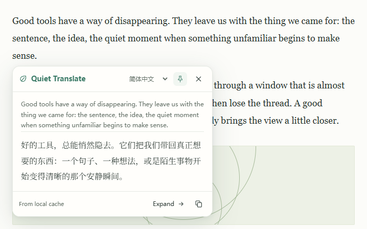
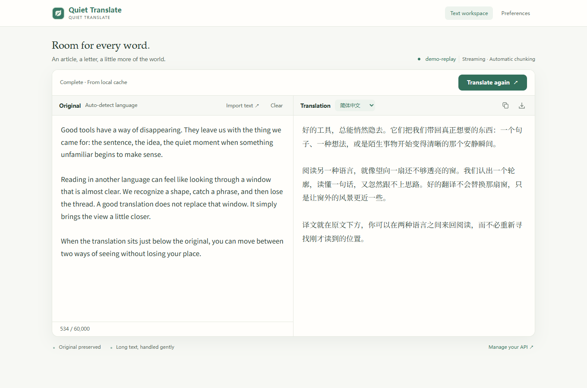
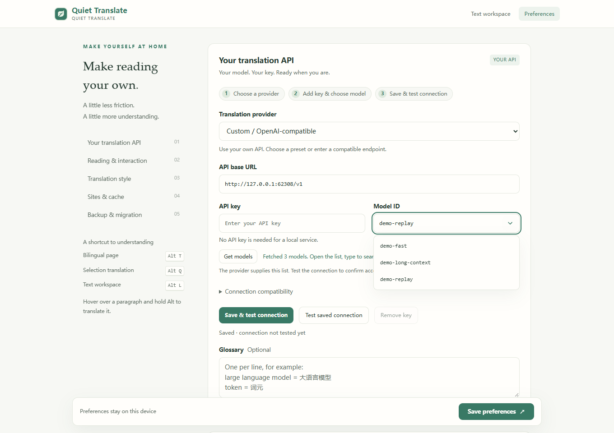

<p align="center"></p>

# Quiet Translate · 轻译

**The original in sight. Translation just below.**

A small, open-source browser extension for bilingual reading, selection translation, and long text. Bring your own OpenAI-compatible API, or connect a localhost model. No project account. No telemetry. No runtime dependencies.

English · [简体中文](README.zh-CN.md)

[](https://github.com/ZJUZhiyuCai/quiet-translate/actions/workflows/ci.yml) [](LICENSE)

[**Install with your agent**](INSTALL.md) · [Download v1.3.1](https://github.com/ZJUZhiyuCai/quiet-translate/releases/latest) · [Installation](docs/BROWSERS.md) · [Connect your API](docs/PROVIDERS.md) · [Report a bug](https://github.com/ZJUZhiyuCai/quiet-translate/issues/new/choose)


**1.3.1** adds ready-to-edit presets for DeepSeek, Zhipu GLM, Qwen (Beijing / Singapore), Kimi, MiniMax, SiliconFlow, and Doubao. Presets fill the endpoint, starting model where available, and compatible request settings. On Mac, shortcuts display **⌥ Option** and **⌘ Cmd**. [Provider details →](docs/PROVIDERS.md)

## Read without losing your place

- **Bilingual pages.** Keep the original text and links; add translations underneath. Only nearby passages enter the translation queue. Restore the page in one action.
- **Selection and hover.** A small button appears after selection. Stream into a compact card, pin it, copy, or open it in the workspace. Hold Alt over a paragraph to translate just that passage.
- **Room for long text.** Up to 60,000 characters, automatic chunking, ordered streaming, cancellation, TXT/Markdown import, and bilingual text export. Original and translation sit side by side in wide windows and stack in narrow ones.
- **Your API.** Ready-to-edit Chinese provider presets, OpenAI, OpenRouter, and local Ollama. Presets fill addresses, starting models where available, and compatibility defaults; you supply your own key. Provider charges apply.
- **Quiet by default.** No permanent floating button. Three translation styles, light/dark themes, glossary, per-site controls, and a local cache. Chinese/English UI; 12 target languages.

Version **1.3.0** adds agent-assisted installation and updates, one-action API setup, and encrypted migration between browsers. Reading fonts remain local; inline translations keep the website's own typeface. [What's changed →](CHANGELOG.md)

### Translate a passage, keep your place

The selection card keeps the source nearby. Pin it while reading, copy the translation, or expand it into the workspace.



### Give longer text some room

Import or paste text, watch the translation arrive, and export both languages together. The main action stays visible in narrow windows too.



Screenshots show the actual v1.3.0 interface with an authored demo article and fixed sample translations replayed locally. Selection and workspace show completed cache hits, not API speed measurements. [Image sources and reproduction →](docs/assets/README.md)

## Let your agent install it

Copy this into your desktop agent, changing the browser name if needed:

```text
Install Quiet Translate in Comet: https://github.com/ZJUZhiyuCai/quiet-translate
Read INSTALL.md and follow its workflow. If already installed, update in the same folder.
Handle download, checksum verification and browser setup. Ask me for required confirmations or my own API details.
Verify the loaded version, API connection and one translation before reporting success.
```

The [agent guide](INSTALL.md) handles new installs, repeatable updates, rollback, and migration. The release includes a Python 3.10+ installer with no third-party dependencies. It prepares verified files; an agent with desktop UI access completes browser loading. If the agent cannot operate a browser confirmation or file chooser, it tells you the exact remaining step. **No store account is needed.**

Chrome, Edge and Comet use the Chromium package. Brave uses the same package but has not been independently tested. Firefox remains an **unsigned temporary installation until restart**. Safari/mobile are not supported. [Manual installation and browser matrix →](docs/BROWSERS.md)

### Connect once, then read

Choose a provider, review its filled-in endpoint and model, enter your own **API key**, and click **Save & test connection**. Allow access to your API host when prompted. A successful test offers the text workspace; refresh existing article tabs to enable selection translation.



This setup screenshot uses a localhost demo, with no personal key and no live-provider connection result. Presets now fill service addresses, starting models where available, and compatibility defaults. Doubao needs your enabled Model ID or endpoint ID; Ollama needs an installed model. [Provider details →](docs/PROVIDERS.md)

**Updating?** Ask your agent to update the original loaded directory, then reload the existing extension. Settings stay in that browser installation. A sibling code backup supports rollback; updates run when requested, not through a background updater.

**Moving browsers or folders?** Preferences → Backup & migration exports a key-free profile or a password-encrypted backup containing the key. Read it in the new installation, review the endpoint, then save and test. Versions before 1.3.0 need an in-place update before exporting. [Migration steps →](INSTALL.md#move-to-another-folder-or-browser)

## Everyday shortcuts

| Action | Shortcut |
|---|---|
| Bilingual page / restore original | Alt+T |
| Translate selected text | Alt+Q, or the selection button |
| Translate one paragraph | Hover and hold Alt |
| Open text workspace | Alt+L |
| Translate in workspace | Ctrl+Enter / Cmd+Enter |
| Close selection card | Esc |

On macOS, **Alt means ⌥ Option**: Option+T for bilingual pages, Option+Q for selections, Option+L for the workspace, and hold Option while hovering over a paragraph. Use **⌘ Cmd+Enter** to translate in the workspace. The UI labels follow the operating system. Change conflicting shortcuts in your browser's extension shortcut manager.

## Speed and verification

Four requests maximum, with capacity reserved for selections. Identical requests share work; cached results skip the network. Later long-text chunks wait for earlier chunks so visible output grows in order.

In the **October 12, 2026** live sample with GLM 5.3 Flash, five selections across MDN, Wikipedia, and Paul Graham had **1.344 s median time to first text**, with cache disabled. A 7,167-character workspace sample completed in **11.073 s**. This sample preceded the final typography refinement; it is not a controlled comparison or a speed guarantee. [Measurements and limits →](docs/FRONTEND-QA.md#live-api-sample)

For v1.3.1, Chrome, Edge, and Comet each passed **110 checks** (including 30 provider/Mac-label checks); Firefox passed **10 end-to-end checks**. Coverage includes layout, selection positioning, settings races, onboarding, encrypted migration, and light/dark contrast. Filesystem tests cover install, repeat, update, rejected packages, and rollback. Node tests and reproducible-package checks also pass. [Provider and Mac-label validation →](docs/PROVIDER-PRESETS-QA.md) · [Installation validation →](docs/AGENT-INSTALL-QA.md) · [Frontend validation →](docs/FRONTEND-QA.md) · [Earlier stress and protocol checks →](docs/QA.md)

## Privacy

Translation sends text to **your configured provider**. The project runs no translation proxy and collects no analytics. API keys stay in extension-origin storage, are never exposed to page/content scripts, and are not synced. Changing provider domains requires a new key. Cache can be disabled or cleared; incognito requests do not write persistent translations. [Full data flow and limitations →](PRIVACY.md)

## Build & contribute

Node.js 22+ and Python 3.10+:

```sh
npm ci
npm run verify
npm run lint:firefox
npm run test:chromium
npm run test:firefox
```

Browser tests use isolated profiles and a dummy localhost API. `QT_CHROMIUM_BINARY`, `QT_FIREFOX_BINARY`, and `QT_GECKODRIVER` can select executables. ZIPs and SHA-256 checksums are generated in `dist/`. See [CONTRIBUTING](CONTRIBUTING.md) for setup and architecture, [SECURITY](SECURITY.md) for private reports, and the [roadmap](docs/ROADMAP.md) for what comes next.

## Inspiration

Vertical bilingual reading and focused selection translation are useful ideas demonstrated by [Immersive Translate](https://immersivetranslate.com/en/). [TWP](https://github.com/FilipePS/Traduzir-paginas-web) is another established reference for page-translation workflows. Quiet Translate independently implements a small BYO-API reading tool; it is not affiliated with either project. No third-party extension source was copied.

The separation of interface, input, and reading fonts draws on [DSH Ivory](https://github.com/ZJUZhiyuCai/dsh-ivory). [Typography details →](docs/FRONTEND-QA.md#typography-refinement)

[MIT](LICENSE). Demo articles and translations are included in the repository; screenshots contain no personal browsing content or credentials.
