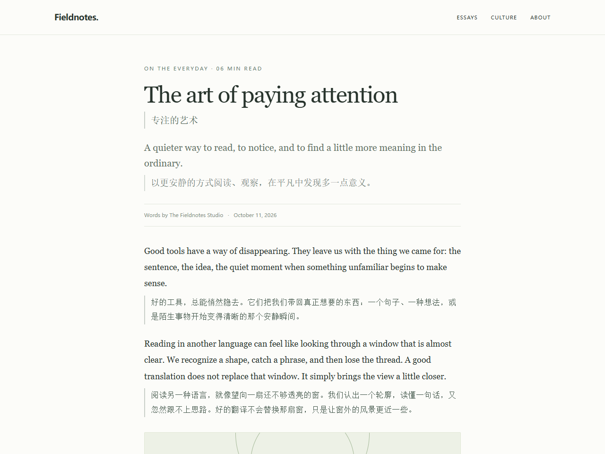
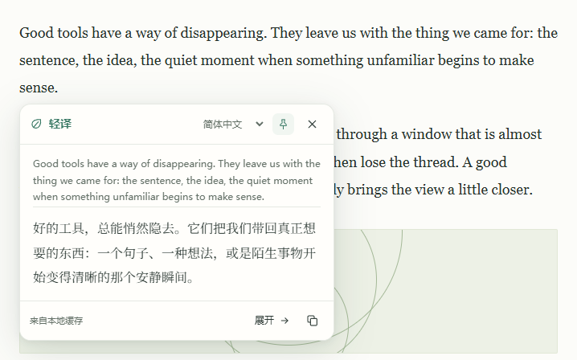
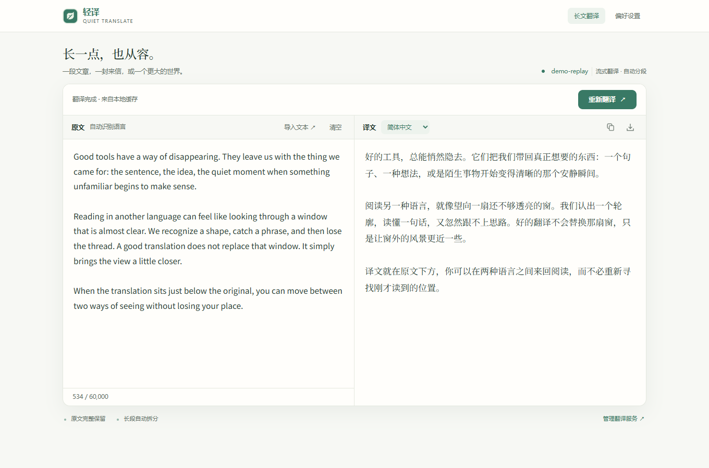

# 轻译 · Quiet Translate

**原文留在眼前，译文恰好在下面。**

一个安静的开源翻译插件：保留原文的网页双语、划线翻译、长文工作台。用户自己填写 API，也能连接本地模型。无需注册本项目账户，没有分析追踪，没有运行时依赖。

[English](README.md) · 简体中文

 

[**下载 v1.2.0**](https://github.com/ZJUZhiyuCai/quiet-translate/releases/latest) · [安装与浏览器支持](docs/BROWSERS.md) · [API 配置](docs/PROVIDERS.md) · [反馈问题](https://github.com/ZJUZhiyuCai/quiet-translate/issues/new/choose)

## 把注意力留给内容

- **网页双语**：原文和链接保留，译文放在下面；只处理读到附近的段落，一键恢复。
- **划线翻译**：选中后才出现小按钮；流式浮层可固定、复制、展开到长文工作台。鼠标悬停并按住 Alt，可只译一段。
- **长文工作台**：最多 60,000 字符，自动分段、顺序流式显示、随时取消，支持 TXT / Markdown 导入与双语文本导出。宽窗口左右对照，窄窗口上下排列。
- **自带 API**：支持 OpenAI 兼容 Chat Completions 接口，提供多个服务地址预设。模型、密钥和 API 费用由使用者自行管理。
- **自然融入**：无常驻悬浮球；细边线、柔和底色、纯文字三种样式，深浅色、术语表、网站规则和本地缓存。界面跟随浏览器显示中英文，提供 12 种目标语言。

**1.2.0** 改进了阅读字体、控件和中英混排输入。译文采用更有书页感的衬线字体，界面保持清晰；字体取自本机，网页中的双语译文继续沿用原网站字体。[更新记录 →](CHANGELOG.md)

### 选中一段，继续阅读

浮层保留原文摘要，可固定、复制，也可展开到长文工作台。

### 长一点，也能从容对照

粘贴或导入文字，译文随生成展开，完成后可导出双语文本。窄窗口也能直接找到翻译按钮。

截图来自实际运行的 v1.2.0，使用项目自制文章和本地回放的固定演示译文。划线和工作台展示的是缓存完成状态，不代表 API 响应速度。[图片来源与复现方法 →](docs/assets/README.md)

## 安装

**Chrome / Edge / Comet**：下载 Releases 中的 Chromium ZIP，解压到固定目录；进入浏览器扩展管理页，打开开发者模式，点“加载未打包的扩展程序”，选择含 `manifest.json` 的文件夹。Brave 可使用同一包，但本轮尚未单独实测。

**Firefox**：下载 Firefox ZIP 并解压；在 `about:debugging` →“此 Firefox”→“临时载入附加组件”中选 `manifest.json`。当前是**未签名开发包，重启后需要重新加载**，尚未发布到 AMO。

首次安装会打开设置。填写接口地址、模型 ID 和自己的 API 密钥，保存并允许访问接口，再测试连接。已打开的网页需要刷新。详见[兼容矩阵、更新方式和限制](docs/BROWSERS.md)。Safari 和移动端尚未完成验证。

**已安装 Chromium 版本？** 将新版本覆盖到原来的安装目录，在扩展管理页点击“重新加载”，再刷新需要翻译的网页。沿用原来的安装，可以保留已保存的 API 配置和偏好。

## 常用操作

| 操作 | 方式 |
|---|---|
| 网页双语 / 恢复原文 | Alt+T |
| 划线翻译 | 选中文字后点小按钮，或 Alt+Q |
| 翻译一个段落 | 悬停并按住 Alt 约半秒 |
| 长文工作台 | Alt+L |
| 工作台开始翻译 | Ctrl+Enter / Cmd+Enter |
| 关闭浮层 | Esc |

快捷键冲突时可在浏览器的扩展快捷键管理页修改。

## 响应与验证

最多 4 路请求，为即时划线预留容量；重复请求合并，本地缓存直接复用；长文后续分块不会抢到前面，避免阅读位置跳动。

**2026 年 10 月 12 日**的 GLM 5.3 Flash 实测覆盖 MDN、Wikipedia、Paul Graham：关闭缓存的 5 次划线，首字中位数 **1.344 秒**；7,167 字符的工作台样本 **11.073 秒**完成。这轮测量早于最后的字体调整，属于特定网络和模型下的小样本，不是严格对照实验或速度承诺。[逐项测量与限制 →](docs/FRONTEND-QA.md#live-api-sample)

1.2.0 在 Chrome、Edge、Comet 中各通过 **64 项检查**，Firefox 通过 **9 项端到端检查**，覆盖排版、划线定位、设置状态冲突和深浅色对比度。单元测试和安装包可复现检查也已通过。[新版验证 →](docs/FRONTEND-QA.md) · [此前的压力与协议验证 →](docs/QA.md)

## 数据与隐私

只有翻译所需文字和请求参数会发送到你配置的服务；模型服务如何处理数据，以其政策为准。本项目没有中转服务器或遥测。密钥保存在扩展独立存储，网页和内容脚本拿不到密钥，不参与同步。换服务域名时须重新填写密钥；缓存可关闭或清空。[隐私说明 →](PRIVACY.md)

## 开发与贡献

需要 Node.js 22+、Python 3.10+。`npm ci` 安装开发工具，`npm run verify` 检查并构建；`npm run lint:firefox` 校验 Firefox 包。浏览器回归为 `npm run test:chromium` / `npm run test:firefox`，使用独立配置和虚拟密钥。[贡献指南](CONTRIBUTING.md) · [路线图](docs/ROADMAP.md) · [MIT 许可证](LICENSE)

产品交互借鉴成熟翻译工具的双语阅读与按需翻译经验，代码独立实现。感谢 [Immersive Translate](https://immersivetranslate.com/en/) 与 [TWP](https://github.com/FilipePS/Traduzir-paginas-web) 展示了这一类工具值得打磨的方向。

界面、输入与阅读字体的分工参考了 [DSH Ivory](https://github.com/ZJUZhiyuCai/dsh-ivory)。[字体设计与验证 →](docs/FRONTEND-QA.md#typography-refinement)

演示文章和译文随项目以 [MIT 许可证](LICENSE) 提供；截图不包含个人浏览内容或密钥。
