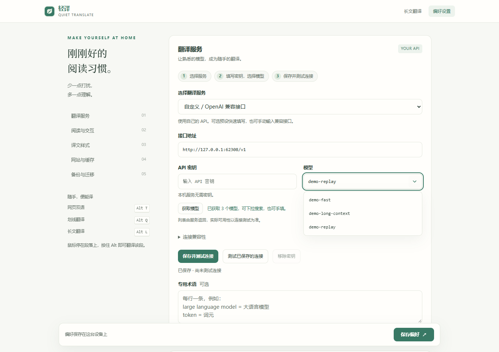

<p align="center"></p>

# 轻译 · Quiet Translate

**原文留在眼前，译文恰好在下面。**

一个安静的开源翻译插件：保留原文的网页双语、划线翻译、长文工作台。用户自己填写 API，也能连接本地模型。无需注册本项目账户，没有分析追踪，没有运行时依赖。

[English](README.md) · 简体中文

[](https://github.com/ZJUZhiyuCai/quiet-translate/actions/workflows/ci.yml) [](LICENSE)

[**让 Agent 安装**](INSTALL.md) · [下载 v1.4.0](https://github.com/ZJUZhiyuCai/quiet-translate/releases/latest) · [安装与浏览器支持](docs/BROWSERS.md) · [API 配置](docs/PROVIDERS.md) · [反馈问题](https://github.com/ZJUZhiyuCai/quiet-translate/issues/new/choose)


## 把注意力留给内容

- **网页双语**：原文和链接保留，译文放在下面；只处理读到附近的段落，一键恢复。
- **划线翻译**：选中后才出现小按钮；流式浮层可固定、复制、展开到长文工作台。鼠标悬停并按住 Alt，可只译一段。
- **长文工作台**：最多 60,000 字符，自动分段、顺序流式显示、随时取消，支持 TXT / Markdown 导入与双语文本导出。宽窗口左右对照，窄窗口上下排列。
- **自带 API**：支持 OpenAI 兼容 Chat Completions 接口，提供多个服务地址预设。模型、密钥和 API 费用由使用者自行管理。
- **自然融入**：无常驻悬浮球；细边线、柔和底色、纯文字三种样式，深浅色、术语表、网站规则和本地缓存。界面跟随浏览器显示中英文，提供 12 种目标语言。

**1.4.0** 填好 API 密钥后自动获取模型，支持下拉搜索、键盘选择；接口不支持或获取失败时，仍可手填。缺少接口访问权限时会提供授权按钮。[模型获取说明 →](docs/PROVIDERS.md#model-discovery)

**1.3.1** 新增国产服务预设：DeepSeek、智谱 GLM、通义千问（北京 / 新加坡）、Kimi、MiniMax、硅基流动、豆包。选择服务后带入接口、起始模型和兼容参数，保留手动修改；Mac 自动显示 ⌥ Option / ⌘ Cmd。

**1.3.0** 加入 Agent 辅助安装与更新、一键保存并测试 API、跨浏览器加密迁移。阅读字体继续取自本机，网页中的双语译文沿用原网站字体。[更新记录 →](CHANGELOG.md)

### 选中一段，继续阅读

浮层保留原文摘要，可固定、复制，也可展开到长文工作台。


### 长一点，也能从容对照

粘贴或导入文字，译文随生成展开，完成后可导出双语文本。窄窗口也能直接找到翻译按钮。


截图来自实际运行的 v1.3.0，使用项目自制文章和本地回放的固定演示译文。划线和工作台展示的是缓存完成状态，不代表 API 响应速度。[图片来源与复现方法 →](docs/assets/README.md)

## 交给你的 Agent 安装

复制下面这段给桌面 Agent，把 Comet 换成你使用的浏览器即可：

```text
帮我在 Comet 安装 Quiet Translate：https://github.com/ZJUZhiyuCai/quiet-translate
先读 INSTALL.md，按其中流程操作。若已安装，沿用原目录更新，保留设置。
自动完成下载、校验和浏览器中可操作的步骤；需要我确认权限或填写自己的 API 时再提示。
最后验证扩展版本、连接测试和一次实际翻译，不要把解压成功当成安装完成。
```

[Agent 安装指南](INSTALL.md)包含首次安装、更新、回退和迁移。Release 提供仅依赖 Python 3.10+ 标准库的安装器，自动下载并校验安装包。具备桌面操作能力的 Agent 可以继续完成浏览器加载；遇到无法操作的权限提示或文件选择框，会给出准确的剩余步骤。**无需商店账号，也无需本项目账号。**

Chrome、Edge、Comet 使用 Chromium 包；Brave 可使用同一包，但尚未单独实测。Firefox 仍是**未签名临时安装，重启后需要重新加载**。Safari 和移动端尚未支持。[手动安装与兼容矩阵 →](docs/BROWSERS.md)

### 连好 API，开始阅读

选择服务商，确认接口并填写自己的 **API 密钥**。停止输入后自动获取模型；尚未授权接口时，点击**允许访问并获取模型**。点开模型字段右侧的箭头，输入名称搜索并选择；获取不了或列表里没有时，直接手填即可。豆包也可填写自己开通的 Model ID 或接入点 ID；本机服务点击**获取模型**读取已安装的模型。点击**保存并测试连接**，按浏览器提示允许访问接口。测试成功后可直接打开长文工作台；刷新已打开的文章页即可使用划线翻译。



设置截图使用本机演示模型列表，不含个人密钥，也未展示真实模型的连接速度。预设填写地址、起始模型与兼容参数，模型可以修改；服务权限和 API 费用由使用者自行管理。[各厂商配置说明 →](docs/PROVIDERS.md)

**更新旧版：** 让 Agent 沿用原来的加载目录更新，再重新加载同一张扩展卡片，可以保留 API 设置和偏好。安装器保留旧代码备份以便回退；更新由用户委托 Agent 执行，不会在后台自行更新。

**换浏览器或目录：** 在“偏好设置 → 备份与迁移”中导出不含密钥的配置，或包含密钥的加密备份；在新安装中读取、确认接口地址，再保存并测试。1.3.0 之前的版本先原地更新，再导出。[迁移步骤 →](INSTALL.md#move-to-another-folder-or-browser)

## 常用操作

| 操作 | 方式 |
|---|---|
| 网页双语 / 恢复原文 | Alt+T |
| 划线翻译 | 选中文字后点小按钮，或 Alt+Q |
| 翻译一个段落 | 悬停并按住 Alt 约半秒 |
| 长文工作台 | Alt+L |
| 工作台开始翻译 | Ctrl+Enter / Cmd+Enter |
| 关闭浮层 | Esc |

**Mac 的 Alt 对应 ⌥ Option**：Option+T 网页双语、Option+Q 划线翻译、Option+L 长文工作台；悬停翻译时按住 Option，工作台用 ⌘ Cmd+Enter 开始。界面会按系统显示对应按键。快捷键冲突时可在浏览器的扩展快捷键管理页修改。

## 响应与验证

最多 4 路请求，为即时划线预留容量；重复请求合并，本地缓存直接复用；长文后续分块不会抢到前面，避免阅读位置跳动。

**2026 年 10 月 12 日**的 GLM 5.3 Flash 实测覆盖 MDN、Wikipedia、Paul Graham：关闭缓存的 5 次划线，首字中位数 **1.344 秒**；7,167 字符的工作台样本 **11.073 秒**完成。这轮测量早于最后的字体调整，属于特定网络和模型下的小样本，不是严格对照实验或速度承诺。[逐项测量与限制 →](docs/FRONTEND-QA.md#live-api-sample)

1.4.0 在 Chrome、Edge、Comet 中各通过 **143 项检查**（包含新增的 33 项模型获取检查），Firefox 通过 **14 项端到端检查**，覆盖排版、划线定位、首次配置、加密迁移和深浅色对比度。安装器还验证了重复安装、更新失败恢复、包校验和回退；单元测试与安装包可复现检查也已通过。[模型获取验证 →](docs/MODEL-DISCOVERY-QA.md) · [预设与 Mac 文案验证 →](docs/PROVIDER-PRESETS-QA.md) · [安装与迁移验证 →](docs/AGENT-INSTALL-QA.md) · [界面验证 →](docs/FRONTEND-QA.md) · [此前的压力与协议验证 →](docs/QA.md)

## 数据与隐私

只有翻译所需文字和请求参数会发送到你配置的服务；模型服务如何处理数据，以其政策为准。本项目没有中转服务器或遥测。密钥保存在扩展独立存储，网页和内容脚本拿不到密钥，不参与同步。换服务域名时须重新填写密钥；缓存可关闭或清空。[隐私说明 →](PRIVACY.md)

## 开发与贡献

需要 Node.js 22+、Python 3.10+。`npm ci` 安装开发工具，`npm run verify` 检查并构建；`npm run lint:firefox` 校验 Firefox 包。浏览器回归为 `npm run test:chromium` / `npm run test:firefox`，使用独立配置和虚拟密钥。[贡献指南](CONTRIBUTING.md) · [路线图](docs/ROADMAP.md) · [MIT 许可证](LICENSE)

产品交互借鉴成熟翻译工具的双语阅读与按需翻译经验，代码独立实现。感谢 [Immersive Translate](https://immersivetranslate.com/en/) 与 [TWP](https://github.com/FilipePS/Traduzir-paginas-web) 展示了这一类工具值得打磨的方向。

界面、输入与阅读字体的分工参考了 [DSH Ivory](https://github.com/ZJUZhiyuCai/dsh-ivory)。[字体设计与验证 →](docs/FRONTEND-QA.md#typography-refinement)

演示文章和译文随项目以 [MIT 许可证](LICENSE) 提供；截图不包含个人浏览内容或密钥。
