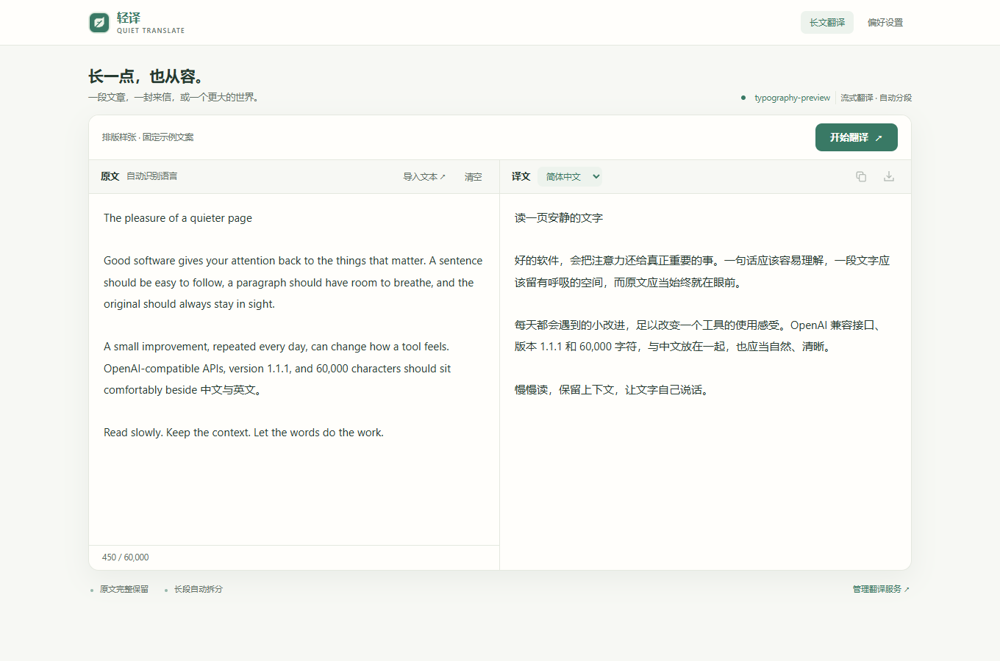
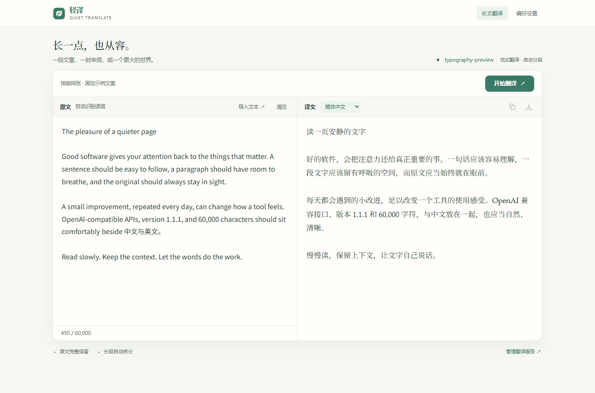
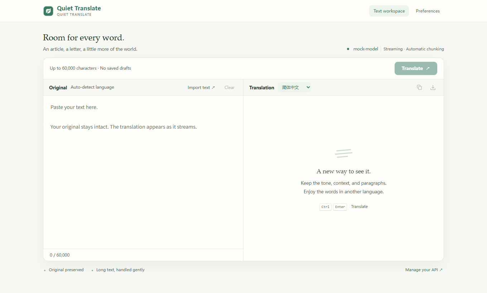

# Frontend upgrade validation

2026-10-12 · Windows · development branch based on v1.1.1. This report describes the unreleased frontend upgrade, not the downloadable v1.1.1 packages. MiniMax implemented the initial interface revision through DeepSeek Harness; Codex reviewed, corrected, and validated it.

## Accepted interface changes

- A compact popup leads with the page translation action. Its workspace description fits without truncation.
- The workspace keeps its primary action in the first viewport and puts each toolbar inside the pane it controls. Original text and translation stack with their own headings on narrow screens.
- An unconfigured workspace shows a persistent settings link. Preferences start with the API connection and navigation follows the actual section order.
- The fixed save bar reserves scrolling space; focused fields and notifications stay above it. Chinese and English interfaces keep the paper/green palette, with more readable secondary text.

## Corrections made during review

1. Testing a saved connection could label unrelated unsaved edits as saved. Connection feedback now never changes the draft's save state.
2. Saving or removing a credential cancels and invalidates the previous connection probe. A late result cannot re-enable testing or mark a different connection verified. Removing a key preserves other draft fields and reports a completed change when there is no draft.
3. The selection card used stale coordinates and capped its assumed height at 360 px. It now retains the selection Range, measures the rendered card, bounds its scrollable body, and coalesces position updates to animation frames. Its chosen side stays stable while there is sufficient room. Pinning and internal scrolling do not move it.
4. The overlay host's `all: initial !important` reset defeated host-level font and text-color rules. Typography, foreground color, and color scheme now apply inside the shadow tree. Regression checks require readable text contrast in both themes and an independent UI font.
5. One-off capture scripts depended on a local drive and ignored helper files. They remain local evidence; maintainable state and layout checks run in the existing Chromium suite instead. Concurrent runs receive unique profile/output directories.

## Typography refinement

The font roles in [DSH Ivory's stylesheet](https://github.com/ZJUZhiyuCai/dsh-ivory/blob/e9b36c8db54bed72852847cf56dcf22f0943ce26/src/skin.css#L33) informed this pass. Interface controls use a system sans-serif; mixed Chinese/English input starts with CJK-capable sans-serif faces; workspace and selection translations use a serif reading stack; connection values and shortcut keys use monospace. Inline bilingual translations continue to inherit the original website's font.

| Surface | Treatment |
|---|---|
| Controls and navigation | System sans-serif, with Chinese fallbacks |
| Source editor | CJK-first sans-serif, 15.5 px / 1.85 |
| Workspace translation | Serif, 17 px / 1.85 |
| Selection translation | Serif, 16 px / 1.9 |
| Connection fields | Monospace, 12.5 px |

On this Windows machine, Comet reported Palatino Linotype for Latin and Noto Serif SC for Chinese result glyphs, plus Microsoft YaHei UI for Chinese controls. The editor's computed stack was verified, but its native textarea did not expose glyph-level font data. Actual faces depend on installed platform fonts. No fonts are bundled, downloaded, or requested remotely; the fixed workspace specimen made no HTTP(S) requests.

Comet's injected extension stylesheet sets a body font and 75% font size, overriding declarations inherited from the root. An explicit body font and `1rem` size now establish the intended interface typography. Desktop, 430 px, 360 px, light/dark, settings, popup, and selection screenshots were reviewed; the four workspace specimen layouts had no horizontal overflow. Browser checks in the table below were rerun after this refinement.

The same fixed, authored text appears in these before/after specimens. They illustrate typography, not API output or measured translation speed.

Before: previous frontend revision

## Verification

- `npm run check`: 31 extension files pass syntax, CSP, manifest-resource, and public-bootstrap checks.
- `npm test`: 30 tests pass.
- Packaging and reproducibility checks pass for both builds. Firefox static validation reports zero errors, warnings, or notices.
- The Chromium suite includes 24 reading/stress checks, 12 structural regressions, and 28 frontend checks. The frontend coverage includes draft/probe races, missing configuration, keyboard focus above the save bar, 360/430/1360 px layouts, live selection anchoring, pinning, internal scrolling, light/dark contrast, and complete-result controls in a 360 × 240 px viewport.
- Local checks use disposable profiles and a localhost mock SSE server. Their timings are not model benchmarks. `QT_CHROMIUM_BINARY` selects a browser and `QT_BROWSER_LOCALE` selects the interface language. See [Contributing](../CONTRIBUTING.md).

| Browser | Local version | Result |
|---|---|---|
| Chrome | 154.0.8037.99 | 64 checks; English UI |
| Edge | 156.0.4314.15 | 64 checks; English UI |
| Comet | 139.1.7258.19069 | 64 checks; Chinese UI |
| Firefox | 157.0.1 | 9 install/settings/reading/selection/long-text checks |

## Live API sample

Before the typography refinement above, the reviewed layout was additionally exercised in an isolated Comet profile using `glm-5.3-flash`, with cache disabled, on these public pages:

- [MDN: Intersection Observer API](https://developer.mozilla.org/en-US/docs/Web/API/Intersection_Observer_API)
- [Wikipedia: Reading](https://en.wikipedia.org/wiki/Reading)
- [Paul Graham: The Need to Read](https://paulgraham.com/read.html)

| Selection | Source characters | First text | Complete |
|---|---:|---:|---:|
| MDN 1 | 184 | 1.626 s | 1.780 s |
| MDN 2 | 410 | 1.344 s | 2.590 s |
| Wikipedia 1 | 189 | 0.902 s | 1.755 s |
| Wikipedia 2 | 243 | 1.545 s | 2.017 s |
| Paul Graham | 658 | 1.139 s | 3.507 s |

The five first-text samples have a median of 1.344 s. The next animation frame after opening the card was observed in 4–51 ms; this is an approximate UI paint opportunity, not a precise display-latency measurement. Network/model times are samples, not guarantees or a controlled before/after comparison. This sample includes the shadow-isolation font/contrast correction, but predates the serif reading stack. Typography refinement did not change translation or streaming logic; no new live API speed measurement is claimed for it.

The 7,167-character MDN workspace sample produced its first text in 3.284 s and completed in 11.073 s. All 18 numbered passages remained in order, the source was unchanged, and none of 152 observed updates rewrote an already visible prefix. The completed workspace also fit at 430 px.

All three page samples preserved the recorded original DOM nodes and direct text, added no horizontal overflow or navigation translations, and restored without translation hosts or anchors. These are sampled viewport checks, not proof that every page or all content on each site is supported. External website screenshots, API credentials, and disposable browser profiles are excluded from the public repository.

## Layout evidence

These screenshots use a dummy local API configuration, with no personal text or credentials.

